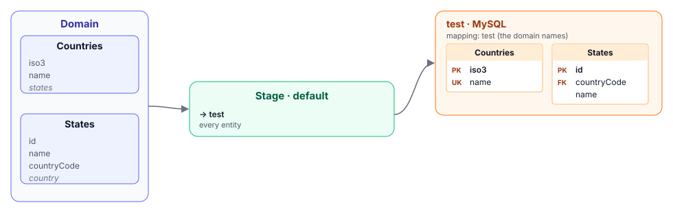

# Ejemplo de esquema básico {#basic-schema-example}

Esta página muestra un esquema básico: dos entidades relacionadas guardadas en una base de datos MySQL.

Un esquema básico define las entidades, el mapping y las fuentes:

- Las **entidades** definen las propiedades, las relaciones y las claves.
- El **mapping** define cómo se mapean las entidades a las tablas de la base de datos.
- Las **fuentes** definen el dialecto y la conexión de cada base de datos.

Muchas claves se pueden omitir, porque tienen un valor por defecto. Por ejemplo:

- Una propiedad sin `type` es un string.
- Una propiedad sin `required` no es obligatoria (salvo que forme parte de la clave primaria o de la clave única).
- Una propiedad string sin `length` es `TEXT` en PostgreSQL y `VARCHAR(80)` en los demás motores.
- Sin información de mapping, las tablas y las columnas tienen los mismos nombres que las entidades y las propiedades.

## Ejemplo de esquema {#schema-example}

En este esquema, `Countries` tiene muchos `States`: la relación `states` de `Countries` devuelve la lista de sus estados, y la relación `country` de `States` devuelve su país.
El mapping `test` está vacío, así que las tablas y las columnas tienen los mismos nombres que las entidades y las propiedades.



```yaml
domain:
  entities:
    - name: Countries
      primaryKey: ["iso3"]
      uniqueKey: ["name"]
      properties:
        - name: name
          required: true
        - name: iso3
          length: 3
          required: true
      relations:
        - name: states
          type: manyToOne
          composite: true
          from: iso3
          entity: States
          to: countryCode
    - name: States
      primaryKey: ["id"]
      uniqueKey: ["countryCode", "name"]
      properties:
        - name: id
          type: integer
          required: true
        - name: name
          required: true
        - name: countryCode
          required: true
          length: 3
      relations:
        - name: country
          from: countryCode
          entity: Countries
          to: iso3
infrastructure:
  mappings:
    - name: test          
  sources:
    - name: test
      dialect: MySQL
      mapping: test
      connection:
        host: localhost
        port: 3306
        user: test
        password: test
        database: test
  stages:
    - name: default
      sources:
        - name: test
```

## Laboratorios {#labs}

- [CLI - simple](https://github.com/lambda-orm/lambdaorm-labs/tree/main/labs/cli/01-simple)
