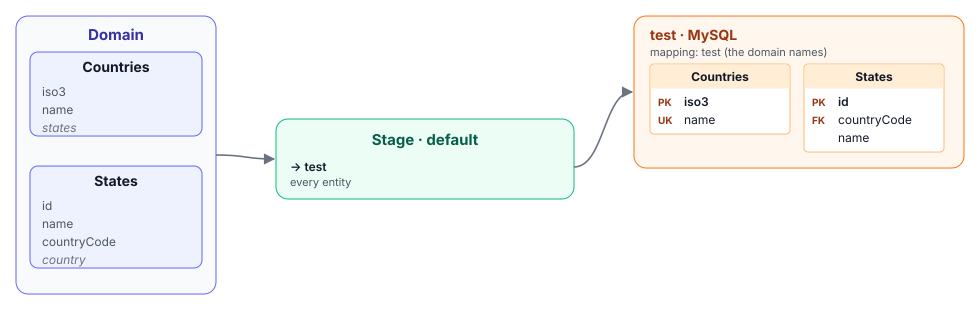

# Basic Schema Example

This page shows a basic schema: two related entities stored in one MySQL database.

A basic schema defines the entities, the mapping and the sources:

- The **entities** define the properties, relations and keys.
- The **mapping** defines how the entities are mapped to the tables of the database.
- The **sources** define the dialect and the connection of each database.

Many keys can be omitted, because they have a default value. For example:

- A property without `type` is a string.
- A property without `required` is not required (unless it is part of the primary or unique key).
- A string property without `length` is `TEXT` on PostgreSQL and `VARCHAR(80)` on the other engines.
- Without mapping information, the tables and columns have the same names as the entities and properties.

## Schema Example

In this schema, `Countries` has many `States`: the relation `states` of `Countries` returns the list of its states, and the relation `country` of `States` returns its country.
The mapping `test` is empty, so the tables and columns have the same names as the entities and properties.



```yaml
domain:
  entities:
    - name: Countries
      primaryKey: ["iso3"]
      uniqueKey: ["name"]
      properties:
        - name: name
          required: true
        - name: iso3
          length: 3
          required: true
      relations:
        - name: states
          type: manyToOne
          composite: true
          from: iso3
          entity: States
          to: countryCode
    - name: States
      primaryKey: ["id"]
      uniqueKey: ["countryCode", "name"]
      properties:
        - name: id
          type: integer
          required: true
        - name: name
          required: true
        - name: countryCode
          required: true
          length: 3
      relations:
        - name: country
          from: countryCode
          entity: Countries
          to: iso3
infrastructure:
  mappings:
    - name: test          
  sources:
    - name: test
      dialect: MySQL
      mapping: test
      connection:
        host: localhost
        port: 3306
        user: test
        password: test
        database: test
  stages:
    - name: default
      sources:
        - name: test
```

## Labs

- [CLI - simple](https://github.com/lambda-orm/lambdaorm-labs/tree/main/labs/cli/01-simple)
