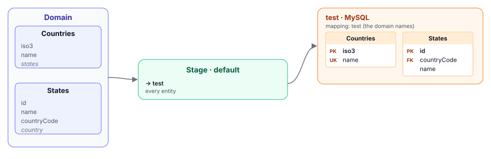

# Exemplo de esquema básico {#basic-schema-example}

Esta página mostra um esquema básico: duas entidades relacionadas armazenadas em um único banco de dados MySQL.

Um esquema básico define as entidades, o mapeamento e as fontes:

- As **entidades** definem as propriedades, as relações e as chaves.
- O **mapeamento** define como as entidades são mapeadas para as tabelas do banco de dados.
- As **fontes** definem o dialeto e a conexão de cada banco de dados.

Muitas chaves podem ser omitidas, porque têm um valor padrão. Por exemplo:

- Uma propriedade sem `type` é uma string.
- Uma propriedade sem `required` não é obrigatória (a menos que faça parte da chave primária ou única).
- Uma propriedade string sem `length` é `TEXT` no PostgreSQL e `VARCHAR(80)` nos demais mecanismos de banco de dados.
- Sem informações de mapeamento, as tabelas e colunas têm os mesmos nomes que as entidades e propriedades.

## Exemplo de esquema {#schema-example}

Neste esquema, `Countries` tem muitos `States`: a relação `states` de `Countries` retorna a lista de seus estados, e a relação `country` de `States` retorna seu país.
O mapeamento `test` está vazio, então as tabelas e colunas têm os mesmos nomes que as entidades e propriedades.



```yaml
domain:
  entities:
    - name: Countries
      primaryKey: ["iso3"]
      uniqueKey: ["name"]
      properties:
        - name: name
          required: true
        - name: iso3
          length: 3
          required: true
      relations:
        - name: states
          type: manyToOne
          composite: true
          from: iso3
          entity: States
          to: countryCode
    - name: States
      primaryKey: ["id"]
      uniqueKey: ["countryCode", "name"]
      properties:
        - name: id
          type: integer
          required: true
        - name: name
          required: true
        - name: countryCode
          required: true
          length: 3
      relations:
        - name: country
          from: countryCode
          entity: Countries
          to: iso3
infrastructure:
  mappings:
    - name: test          
  sources:
    - name: test
      dialect: MySQL
      mapping: test
      connection:
        host: localhost
        port: 3306
        user: test
        password: test
        database: test
  stages:
    - name: default
      sources:
        - name: test
```

## Laboratórios {#labs}

- [CLI - simples](https://github.com/lambda-orm/lambdaorm-labs/tree/main/labs/cli/01-simple)
