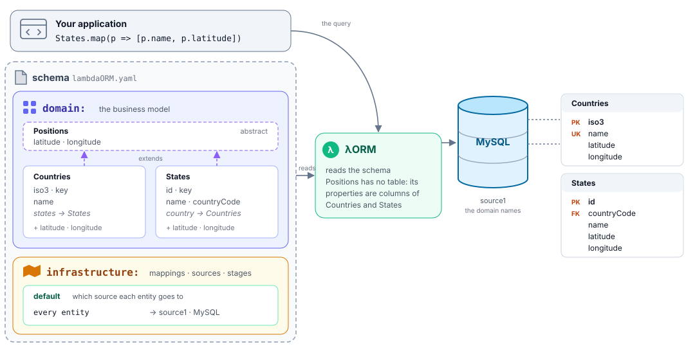

# Erweitern {#extend}

Diese Seite zeigt, wie Definitionen mit dem Schlüssel `extends` wiederverwendet werden.

Mit `extends` erbt ein Element des Schemas die Definition eines anderen. Enums, Entitäten, Mappings und Entitäts-Mappings können erweitert werden.

## Entität erweitern {#extend-entity}

In diesem Schema erweitern die Entitäten `Countries` und `States` die abstrakte Entität `Positions`, sodass beide die Eigenschaften `latitude` und `longitude` erhalten.
Eine Entität muss nicht abstrakt sein, um erweitert zu werden; eine abstrakte Entität dient nur als Basis und hat keine Tabelle.



```yaml
domain:
  entities:
    - name: Positions
      abstract: true
      properties:
        - name: latitude
          length: 16
        - name: longitude
          length: 16
    - name: Countries
      extends: Positions
      primaryKey: ["iso3"]
      uniqueKey: ["name"]
      properties:
        - name: name
          required: true
        - name: iso3
          length: 3
          required: true
      relations:
        - name: states
          type: manyToOne
          composite: true
          from: iso3
          entity: States
          to: countryCode
    - name: States
      extends: Positions
      primaryKey: ["id"]
      uniqueKey: ["countryCode", "name"]
      properties:
        - name: id
          type: integer
          required: true
        - name: name
          required: true
        - name: countryCode
          required: true
          length: 3
      relations:
        - name: country
          from: countryCode
          entity: Countries
          to: iso3
infrastructure:          
  sources:
    - name: source1
      dialect: MySQL
      connection:
        host: localhost
        port: 3306
        user: test
        password: test
        database: test
```

## Mappings erweitern {#extend-mappings}

Mappings und Entitäts-Mappings werden auf dieselbe Weise erweitert. Siehe [Abstract und extends im Entitäts-Mapping](SchemaDefinition.md#abstract-and-extends-in-entity-mapping) sowie das Mapping `mongoDb`, das das Mapping `default` erweitert, im [Listener-Beispiel](SchemaExample-Listener.md#listener-example).

## Labs {#labs}

- [CLI – extend model](https://github.com/lambda-orm/lambdaorm-labs/tree/main/labs/cli/02-extend-model)
