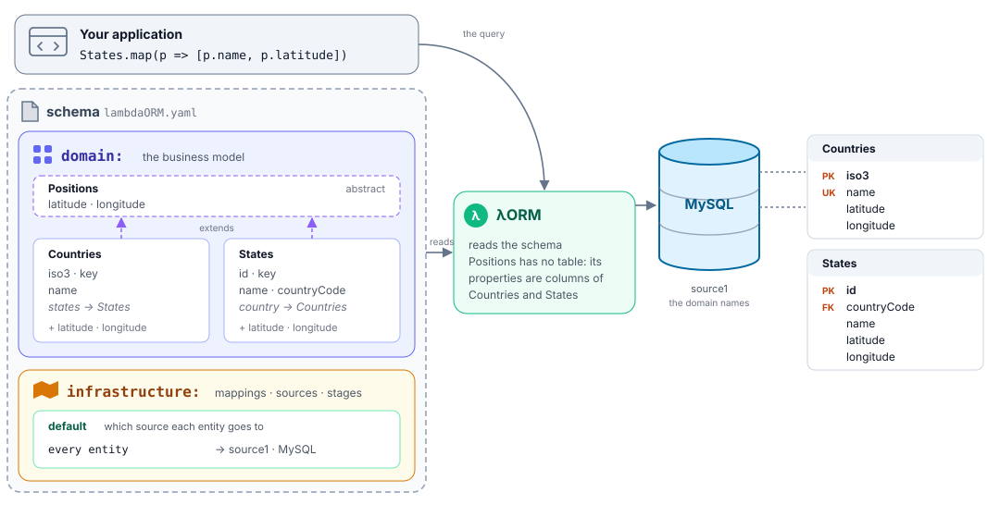

# Extend {#extend}

Esta página muestra cómo reutilizar definiciones con la clave `extends`.

Con `extends`, un elemento del esquema hereda la definición de otro. Se pueden extender enums, entidades, mappings y mappings de entidad.

## Extender una entidad {#extend-entity}

En este esquema, las entidades `Countries` y `States` extienden la entidad abstracta `Positions`, así que ambas obtienen las propiedades `latitude` y `longitude`.
No hace falta que una entidad sea abstracta para poder extenderla; una entidad abstracta es solo una base y no tiene tabla.



```yaml
domain:
  entities:
    - name: Positions
      abstract: true
      properties:
        - name: latitude
          length: 16
        - name: longitude
          length: 16
    - name: Countries
      extends: Positions
      primaryKey: ["iso3"]
      uniqueKey: ["name"]
      properties:
        - name: name
          required: true
        - name: iso3
          length: 3
          required: true
      relations:
        - name: states
          type: manyToOne
          composite: true
          from: iso3
          entity: States
          to: countryCode
    - name: States
      extends: Positions
      primaryKey: ["id"]
      uniqueKey: ["countryCode", "name"]
      properties:
        - name: id
          type: integer
          required: true
        - name: name
          required: true
        - name: countryCode
          required: true
          length: 3
      relations:
        - name: country
          from: countryCode
          entity: Countries
          to: iso3
infrastructure:          
  sources:
    - name: source1
      dialect: MySQL
      connection:
        host: localhost
        port: 3306
        user: test
        password: test
        database: test
```

## Extender mappings {#extend-mappings}

Los mappings y los mappings de entidad se extienden de la misma forma. Ver [Abstract y extends en el mapping de entidad](SchemaDefinition.md#abstract-and-extends-in-entity-mapping), y el mapping `mongoDb`, que extiende el mapping `default`, en el [ejemplo de Listener](SchemaExample-Listener.md#listener-example).

## Laboratorios {#labs}

- [CLI - extend model](https://github.com/lambda-orm/lambdaorm-labs/tree/main/labs/cli/02-extend-model)
