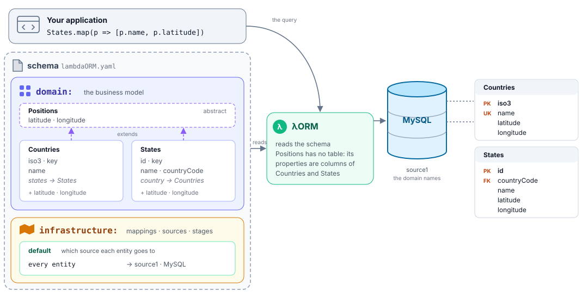

# Extend

This page shows how to reuse definitions with the `extends` key.

With `extends`, an element of the schema inherits the definition of another one. Enums, entities, mappings and entity mappings can be extended.

## Extend Entity

In this schema, the entities `Countries` and `States` extend the abstract entity `Positions`, so both get the properties `latitude` and `longitude`.
An entity does not need to be abstract to be extended; an abstract entity is only a base and has no table.



```yaml
domain:
  entities:
    - name: Positions
      abstract: true
      properties:
        - name: latitude
          length: 16
        - name: longitude
          length: 16
    - name: Countries
      extends: Positions
      primaryKey: ["iso3"]
      uniqueKey: ["name"]
      properties:
        - name: name
          required: true
        - name: iso3
          length: 3
          required: true
      relations:
        - name: states
          type: manyToOne
          composite: true
          from: iso3
          entity: States
          to: countryCode
    - name: States
      extends: Positions
      primaryKey: ["id"]
      uniqueKey: ["countryCode", "name"]
      properties:
        - name: id
          type: integer
          required: true
        - name: name
          required: true
        - name: countryCode
          required: true
          length: 3
      relations:
        - name: country
          from: countryCode
          entity: Countries
          to: iso3
infrastructure:          
  sources:
    - name: source1
      dialect: MySQL
      connection:
        host: localhost
        port: 3306
        user: test
        password: test
        database: test
```

## Extend mappings

Mappings and entity mappings are extended in the same way. See [Abstract and extends in Entity Mapping](SchemaDefinition.md#abstract-and-extends-in-entity-mapping), and the mapping `mongoDb`, which extends the mapping `default`, in the [Listener example](SchemaExample-Listener.md#listener-example).

## Labs

- [CLI - extend model](https://github.com/lambda-orm/lambdaorm-labs/tree/main/labs/cli/02-extend-model)
