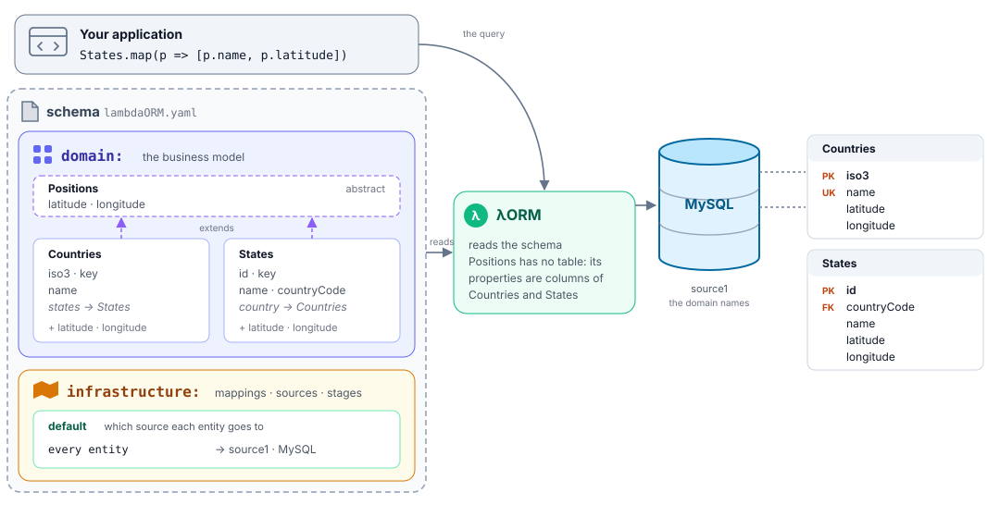

# Extend {#extend}

Esta página mostra como reutilizar definições com a chave `extends`.

Com `extends`, um elemento do esquema herda a definição de outro. Enums, entidades, mapeamentos e mapeamentos de entidade podem ser estendidos.

## Estender uma entidade {#extend-entity}

Neste esquema, as entidades `Countries` e `States` estendem a entidade abstrata `Positions`, então ambas recebem as propriedades `latitude` e `longitude`.
Uma entidade não precisa ser abstrata para ser estendida; uma entidade abstrata é apenas uma base e não tem tabela.



```yaml
domain:
  entities:
    - name: Positions
      abstract: true
      properties:
        - name: latitude
          length: 16
        - name: longitude
          length: 16
    - name: Countries
      extends: Positions
      primaryKey: ["iso3"]
      uniqueKey: ["name"]
      properties:
        - name: name
          required: true
        - name: iso3
          length: 3
          required: true
      relations:
        - name: states
          type: manyToOne
          composite: true
          from: iso3
          entity: States
          to: countryCode
    - name: States
      extends: Positions
      primaryKey: ["id"]
      uniqueKey: ["countryCode", "name"]
      properties:
        - name: id
          type: integer
          required: true
        - name: name
          required: true
        - name: countryCode
          required: true
          length: 3
      relations:
        - name: country
          from: countryCode
          entity: Countries
          to: iso3
infrastructure:          
  sources:
    - name: source1
      dialect: MySQL
      connection:
        host: localhost
        port: 3306
        user: test
        password: test
        database: test
```

## Estender mapeamentos {#extend-mappings}

Mapeamentos e mapeamentos de entidade são estendidos da mesma forma. Veja [Abstract e extends no mapeamento de entidade](SchemaDefinition.md#abstract-and-extends-in-entity-mapping), e o mapeamento `mongoDb`, que estende o mapeamento `default`, no [exemplo de Listener](SchemaExample-Listener.md#listener-example).

## Laboratórios {#labs}

- [CLI - estender o modelo](https://github.com/lambda-orm/lambdaorm-labs/tree/main/labs/cli/02-extend-model)
