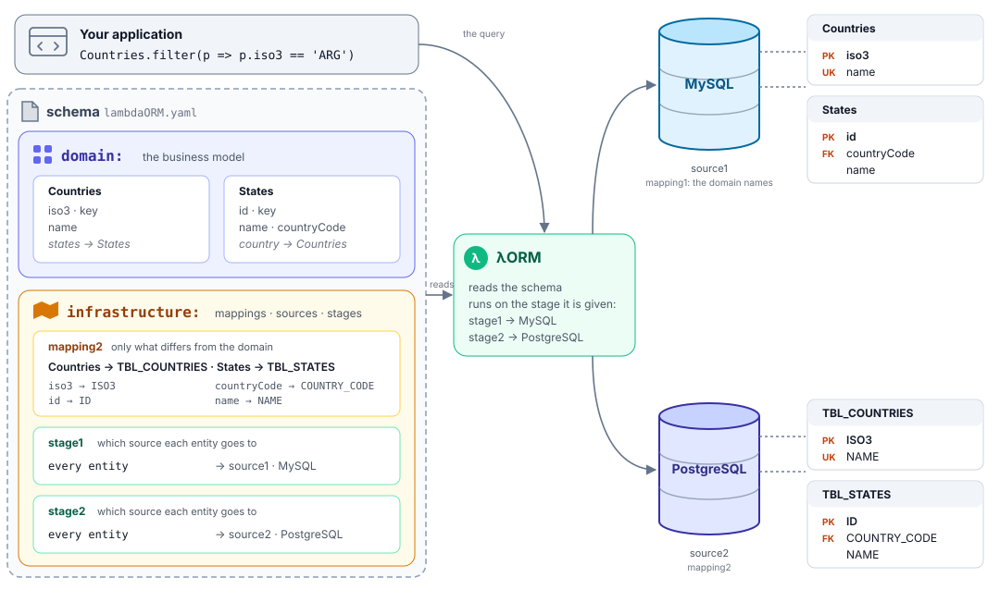

# Multiple Stages

This page shows a schema with two stages: the same model stored in two different databases.

A stage is a usage scenario. Several stages can be defined for different reasons, for example:

- To run the same business model on Oracle and on SQL Server and compare their performance.
- To use one stage as the origin and another as the destination of a data migration.
- To use one stage for reads and another for writes.
- To use one stage for the development environment and another for the QA environment.

## Schema Example

In this schema, `stage1` uses a MySQL database with the default names (`mapping1` is empty), and `stage2` uses a PostgreSQL database whose tables and columns have other names (`mapping2`).
The same query gives the same result on both stages.



```yaml
domain:
  entities:
    - name: Countries
      primaryKey: ["iso3"]
      uniqueKey: ["name"]
      properties:
        - name: name
          required: true
        - name: iso3
          length: 3
          required: true
      relations:
        - name: states
          type: manyToOne
          composite: true
          from: iso3
          entity: States
          to: countryCode
    - name: States
      primaryKey: ["id"]
      uniqueKey: ["countryCode", "name"]
      properties:
        - name: id
          type: integer
          required: true
        - name: name
          required: true
        - name: countryCode
          required: true
          length: 3
      relations:
        - name: country
          from: countryCode
          entity: Countries
          to: iso3
infrastructure:
  mappings:
    - name: mapping1
    - name: mapping2
      entities:
        - name: Countries
          mapping: TBL_COUNTRIES
          properties:
            - name: iso3
              mapping: ISO3
            - name: name
              mapping: NAME
        - name: States
          mapping: TBL_STATES
          properties:
            - name: id
              mapping: ID
            - name: name
              mapping: NAME
            - name: countryCode
              mapping: COUNTRY_CODE
  sources:
    - name: source1
      dialect: MySQL
      mapping: mapping1
      connection: $CNN_MYSQL
    - name: source2
      dialect: PostgreSQL
      mapping: mapping2
      connection: $CNN_POSTGRES
  stages:
    - name: stage1
      sources:
        - name: source1
    - name: stage2
      sources:
        - name: source2
```

**Environment variables:**

```sh
CNN_MYSQL={"host":"localhost","port":3306,"user":"test","password":"test","database":"test"}
CNN_POSTGRES={"host":"0.0.0.0","port":5433,"user":"test","password":"test","database":"test"}
```

## Labs

- [CLI - two stages](https://github.com/lambda-orm/lambdaorm-labs/tree/main/labs/cli/03-two-stages)
