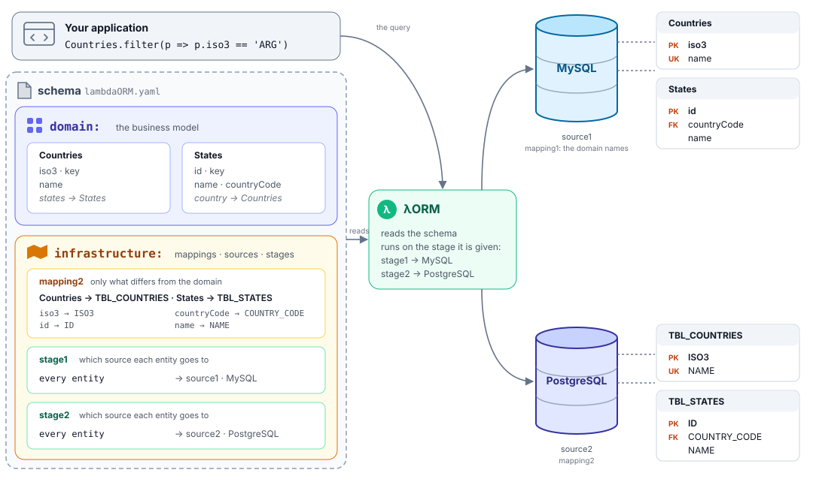

# Múltiplos stages {#multiple-stages}

Esta página mostra um esquema com dois stages: o mesmo modelo armazenado em dois bancos de dados diferentes.

Um stage é um cenário de uso. Vários stages podem ser definidos por diferentes motivos, por exemplo:

- Para executar o mesmo modelo de negócio no Oracle e no SQL Server e comparar seu desempenho.
- Para usar um stage como origem e outro como destino de uma migração de dados.
- Para usar um stage para leituras e outro para gravações.
- Para usar um stage para o ambiente de desenvolvimento e outro para o ambiente de QA.

## Exemplo de esquema {#schema-example}

Neste esquema, `stage1` usa um banco de dados MySQL com os nomes padrão (`mapping1` está vazio), e `stage2` usa um banco de dados PostgreSQL cujas tabelas e colunas têm outros nomes (`mapping2`).
A mesma consulta produz o mesmo resultado nos dois stages.



```yaml
domain:
  entities:
    - name: Countries
      primaryKey: ["iso3"]
      uniqueKey: ["name"]
      properties:
        - name: name
          required: true
        - name: iso3
          length: 3
          required: true
      relations:
        - name: states
          type: manyToOne
          composite: true
          from: iso3
          entity: States
          to: countryCode
    - name: States
      primaryKey: ["id"]
      uniqueKey: ["countryCode", "name"]
      properties:
        - name: id
          type: integer
          required: true
        - name: name
          required: true
        - name: countryCode
          required: true
          length: 3
      relations:
        - name: country
          from: countryCode
          entity: Countries
          to: iso3
infrastructure:
  mappings:
    - name: mapping1
    - name: mapping2
      entities:
        - name: Countries
          mapping: TBL_COUNTRIES
          properties:
            - name: iso3
              mapping: ISO3
            - name: name
              mapping: NAME
        - name: States
          mapping: TBL_STATES
          properties:
            - name: id
              mapping: ID
            - name: name
              mapping: NAME
            - name: countryCode
              mapping: COUNTRY_CODE
  sources:
    - name: source1
      dialect: MySQL
      mapping: mapping1
      connection: $CNN_MYSQL
    - name: source2
      dialect: PostgreSQL
      mapping: mapping2
      connection: $CNN_POSTGRES
  stages:
    - name: stage1
      sources:
        - name: source1
    - name: stage2
      sources:
        - name: source2
```

**Variáveis de ambiente:**

```sh
CNN_MYSQL={"host":"localhost","port":3306,"user":"test","password":"test","database":"test"}
CNN_POSTGRES={"host":"0.0.0.0","port":5433,"user":"test","password":"test","database":"test"}
```

## Laboratórios {#labs}

- [CLI - dois stages](https://github.com/lambda-orm/lambdaorm-labs/tree/main/labs/cli/03-two-stages)
