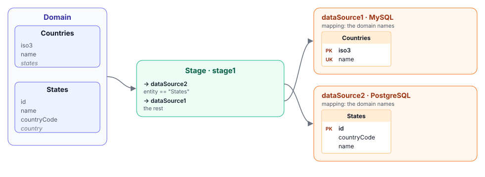

# Stage mit mehreren Quellen {#stage-with-multiple-sources}

Diese Seite zeigt einen Stage, dessen Entitäten in verschiedenen Datenbanken gespeichert sind, zuerst mit demselben Mapping und dann mit einem eigenen Mapping für jede Quelle.

- Wenn sich die Entitäten in verschiedenen Datenbanken befinden, gibt der Stage an, welche Quelle jede Entität verwendet.
- Dies geschieht über die **condition** jeder Quellenregel: einen Ausdruck, der für jede Entität ausgewertet wird; ist er wahr, wird diese Quelle verwendet.
- Die Bedingungen werden in der Reihenfolge des Stages ausgewertet; erfüllt eine Entität die Bedingungen zweier Quellen, wird daher die erste verwendet. Eine Quelle ohne Bedingung übernimmt die Entitäten, die keine vorherige Quelle übernommen hat.

## Mehrere Quellen mit gemeinsamem Mapping {#multiple-sources-sharing-the-mapping}

In diesem Schema wird `States` in einer PostgreSQL-Datenbank (`dataSource2`) und jede andere Entität in einer MySQL-Datenbank (`dataSource1`) gespeichert.
Beide Quellen verwenden dasselbe Mapping (das Standard-Mapping, da keines definiert ist), daher haben die Tabellen und Spalten dieselben Namen wie die Entitäten und Eigenschaften.



```yaml
domain:
  entities:
    - name: Countries
      primaryKey: ["iso3"]
      uniqueKey: ["name"]
      properties:
        - name: name
          required: true
        - name: iso3
          length: 3
          required: true
      relations:
        - name: states
          type: manyToOne
          composite: true
          from: iso3
          entity: States
          to: countryCode
    - name: States
      primaryKey: ["id"]
      uniqueKey: ["countryCode", "name"]
      properties:
        - name: id
          type: integer
          required: true
        - name: name
          required: true
        - name: countryCode
          required: true
          length: 3
      relations:
        - name: country
          from: countryCode
          entity: Countries
          to: iso3
infrastructure:          
  sources:
    - name: dataSource1
      dialect: MySQL
      connection:
        host: localhost
        port: 3306
        user: test
        password: test
        database: test
    - name: dataSource2
      dialect: PostgreSQL
      connection:
        host: localhost
        port: 5432
        user: test
        password: test
        database: test
  stages:
    - name: stage1
      sources:
        - name: dataSource2
          condition: entity == "States"
        - name: dataSource1
```

## Mehrere Quellen mit unterschiedlichen Mappings {#multiple-sources-with-different-mappings}

In diesem Schema ist `dataSource1` eine MySQL-Datenbank, die die Tabelle `Countries` enthält, und `dataSource2` eine PostgreSQL-Datenbank, die die Tabelle `States` enthält.

Bei `Countries` sind die Namen der Tabelle und ihrer Spalten identisch mit den Namen der Entität und ihrer Eigenschaften, daher ist ihr Mapping (`mapping1`) leer.
Bei `States` unterscheiden sich die Namen der Tabelle und ihrer Spalten, daher definiert `mapping2` sie.


```yaml
domain:
  entities:
    - name: Positions
      abstract: true
      properties:
        - name: latitude
          length: 16
        - name: longitude
          length: 16
    - name: Countries
      extends: Positions
      primaryKey: ["iso3"]
      uniqueKey: ["name"]
      properties:
        - name: name
          required: true
        - name: iso3
          length: 3
          required: true
        - name: region
        - name: subregion
      relations:
        - name: states
          type: manyToOne
          composite: true
          from: iso3
          entity: States
          to: countryCode
    - name: States
      extends: Positions
      primaryKey: ["id"]
      uniqueKey: ["countryCode", "name"]
      properties:
        - name: id
          type: integer
          required: true
        - name: name
          required: true
        - name: countryCode
          required: true
          length: 3
      relations:
        - name: country
          from: countryCode
          entity: Countries
          to: iso3
infrastructure:
  mappings:
    - name: mapping1
    - name: mapping2
      entities:
        - name: States
          mapping: TBL_STATES
          properties:
            - name: id
              mapping: ID
            - name: name
              mapping: NAME
            - name: countryCode
              mapping: COUNTRY_CODE
            - name: latitude
              mapping: LATITUDE
            - name: longitude
              mapping: LONGITUDE          
  sources:
    - name: dataSource1
      dialect: MySQL
      mapping: mapping1
      connection: $CNN_MYSQL
    - name: dataSource2
      dialect: PostgreSQL
      mapping: mapping2
      connection: $CNN_POSTGRES
  stages:
    - name: stage1
      sources:
        - name: dataSource2
          condition: entity == "States"
        - name: dataSource1
```

**Umgebungsvariablen:**

```sh
CNN_MYSQL={"host":"localhost","port":3306,"user":"test","password":"test","database":"test"}
CNN_POSTGRES={"host":"localhost","port":5433,"user":"test","password":"test","database":"test"}
```

## Labs {#labs}

- [CLI – two datasource same query](https://github.com/lambda-orm/lambdaorm-labs/tree/main/labs/cli/04-two-datasource-same-query)
