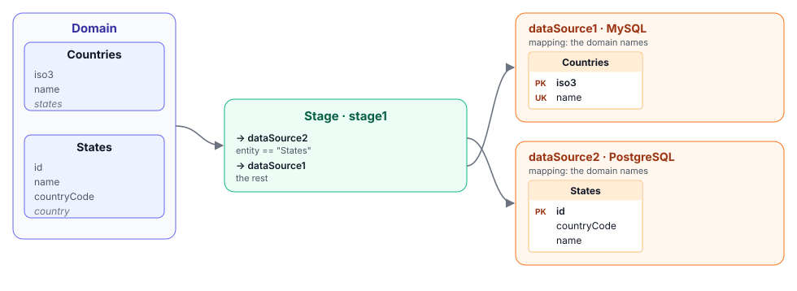
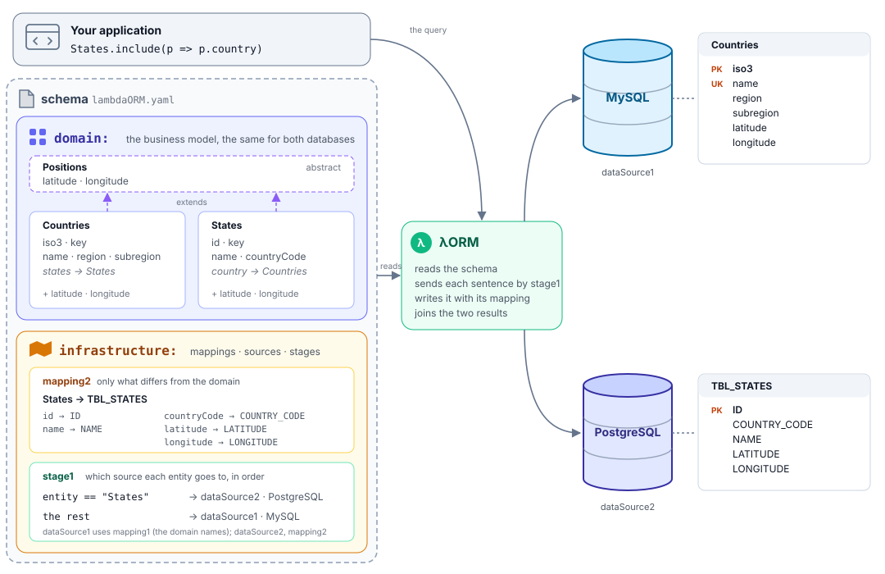

# Stage con varias fuentes {#stage-with-multiple-sources}

Esta página muestra un stage cuyas entidades se guardan en distintas bases de datos, primero con el mismo mapping y después con un mapping distinto para cada fuente.

- Cuando las entidades están en distintas bases de datos, el stage indica qué fuente usa cada entidad.
- Esto se hace con la **condition** de cada regla de fuente: una expresión que se evalúa para cada entidad; cuando es verdadera, se usa esa fuente.
- Las condiciones se evalúan en el orden del stage, así que cuando una entidad cumple las condiciones de dos fuentes, se usa la primera. Una fuente sin condición toma las entidades que no tomó ninguna fuente anterior.

## Varias fuentes que comparten el mapping {#multiple-sources-sharing-the-mapping}

En este esquema, `States` se guarda en una base de datos PostgreSQL (`dataSource2`) y todas las demás entidades en una base de datos MySQL (`dataSource1`).
Ambas fuentes usan el mismo mapping (el mapping por defecto, ya que no se define ninguno), así que las tablas y las columnas tienen los mismos nombres que las entidades y las propiedades.



```yaml
domain:
  entities:
    - name: Countries
      primaryKey: ["iso3"]
      uniqueKey: ["name"]
      properties:
        - name: name
          required: true
        - name: iso3
          length: 3
          required: true
      relations:
        - name: states
          type: manyToOne
          composite: true
          from: iso3
          entity: States
          to: countryCode
    - name: States
      primaryKey: ["id"]
      uniqueKey: ["countryCode", "name"]
      properties:
        - name: id
          type: integer
          required: true
        - name: name
          required: true
        - name: countryCode
          required: true
          length: 3
      relations:
        - name: country
          from: countryCode
          entity: Countries
          to: iso3
infrastructure:          
  sources:
    - name: dataSource1
      dialect: MySQL
      connection:
        host: localhost
        port: 3306
        user: test
        password: test
        database: test
    - name: dataSource2
      dialect: PostgreSQL
      connection:
        host: localhost
        port: 5432
        user: test
        password: test
        database: test
  stages:
    - name: stage1
      sources:
        - name: dataSource2
          condition: entity == "States"
        - name: dataSource1
```

## Varias fuentes con distintos mappings {#multiple-sources-with-different-mappings}

En este esquema, `dataSource1` es una base de datos MySQL que contiene la tabla `Countries`, y `dataSource2` es una base de datos PostgreSQL que contiene la tabla `States`.

Para `Countries`, los nombres de la tabla y de sus columnas son los mismos que los de la entidad y sus propiedades, así que su mapping (`mapping1`) está vacío.
Para `States`, los nombres de la tabla y de sus columnas son distintos, así que `mapping2` los define.



```yaml
domain:
  entities:
    - name: Positions
      abstract: true
      properties:
        - name: latitude
          length: 16
        - name: longitude
          length: 16
    - name: Countries
      extends: Positions
      primaryKey: ["iso3"]
      uniqueKey: ["name"]
      properties:
        - name: name
          required: true
        - name: iso3
          length: 3
          required: true
        - name: region
        - name: subregion
      relations:
        - name: states
          type: manyToOne
          composite: true
          from: iso3
          entity: States
          to: countryCode
    - name: States
      extends: Positions
      primaryKey: ["id"]
      uniqueKey: ["countryCode", "name"]
      properties:
        - name: id
          type: integer
          required: true
        - name: name
          required: true
        - name: countryCode
          required: true
          length: 3
      relations:
        - name: country
          from: countryCode
          entity: Countries
          to: iso3
infrastructure:
  mappings:
    - name: mapping1
    - name: mapping2
      entities:
        - name: States
          mapping: TBL_STATES
          properties:
            - name: id
              mapping: ID
            - name: name
              mapping: NAME
            - name: countryCode
              mapping: COUNTRY_CODE
            - name: latitude
              mapping: LATITUDE
            - name: longitude
              mapping: LONGITUDE          
  sources:
    - name: dataSource1
      dialect: MySQL
      mapping: mapping1
      connection: $CNN_MYSQL
    - name: dataSource2
      dialect: PostgreSQL
      mapping: mapping2
      connection: $CNN_POSTGRES
  stages:
    - name: stage1
      sources:
        - name: dataSource2
          condition: entity == "States"
        - name: dataSource1
```

**Variables de entorno:**

```sh
CNN_MYSQL={"host":"localhost","port":3306,"user":"test","password":"test","database":"test"}
CNN_POSTGRES={"host":"localhost","port":5433,"user":"test","password":"test","database":"test"}
```

## Laboratorios {#labs}

- [CLI - two datasource same query](https://github.com/lambda-orm/lambdaorm-labs/tree/main/labs/cli/04-two-datasource-same-query)
