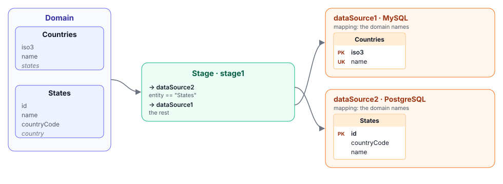

# Stage with Multiple Sources

This page shows a stage whose entities are stored in different databases, first with the same mapping and then with a different mapping for each source.

- When the entities are in different databases, the stage says which source each entity uses.
- This is done with the **condition** of each source rule: an expression evaluated for each entity; when it is true, that source is used.
- The conditions are evaluated in the order of the stage, so when an entity meets the conditions of two sources, the first one is used. A source without condition takes the entities that no previous source took.

## Multiple sources sharing the mapping

In this schema, `States` is stored in a PostgreSQL database (`dataSource2`) and every other entity in a MySQL database (`dataSource1`).
Both sources use the same mapping (the default one, since none is defined), so the tables and columns have the same names as the entities and properties.



```yaml
domain:
  entities:
    - name: Countries
      primaryKey: ["iso3"]
      uniqueKey: ["name"]
      properties:
        - name: name
          required: true
        - name: iso3
          length: 3
          required: true
      relations:
        - name: states
          type: manyToOne
          composite: true
          from: iso3
          entity: States
          to: countryCode
    - name: States
      primaryKey: ["id"]
      uniqueKey: ["countryCode", "name"]
      properties:
        - name: id
          type: integer
          required: true
        - name: name
          required: true
        - name: countryCode
          required: true
          length: 3
      relations:
        - name: country
          from: countryCode
          entity: Countries
          to: iso3
infrastructure:          
  sources:
    - name: dataSource1
      dialect: MySQL
      connection:
        host: localhost
        port: 3306
        user: test
        password: test
        database: test
    - name: dataSource2
      dialect: PostgreSQL
      connection:
        host: localhost
        port: 5432
        user: test
        password: test
        database: test
  stages:
    - name: stage1
      sources:
        - name: dataSource2
          condition: entity == "States"
        - name: dataSource1
```

## Multiple sources with different mappings

In this schema, `dataSource1` is a MySQL database that holds the `Countries` table, and `dataSource2` is a PostgreSQL database that holds the `States` table.

For `Countries`, the names of the table and its columns are the same as the names of the entity and its properties, so its mapping (`mapping1`) is empty.
For `States`, the names of the table and its columns are different, so `mapping2` defines them.


```yaml
domain:
  entities:
    - name: Positions
      abstract: true
      properties:
        - name: latitude
          length: 16
        - name: longitude
          length: 16
    - name: Countries
      extends: Positions
      primaryKey: ["iso3"]
      uniqueKey: ["name"]
      properties:
        - name: name
          required: true
        - name: iso3
          length: 3
          required: true
        - name: region
        - name: subregion
      relations:
        - name: states
          type: manyToOne
          composite: true
          from: iso3
          entity: States
          to: countryCode
    - name: States
      extends: Positions
      primaryKey: ["id"]
      uniqueKey: ["countryCode", "name"]
      properties:
        - name: id
          type: integer
          required: true
        - name: name
          required: true
        - name: countryCode
          required: true
          length: 3
      relations:
        - name: country
          from: countryCode
          entity: Countries
          to: iso3
infrastructure:
  mappings:
    - name: mapping1
    - name: mapping2
      entities:
        - name: States
          mapping: TBL_STATES
          properties:
            - name: id
              mapping: ID
            - name: name
              mapping: NAME
            - name: countryCode
              mapping: COUNTRY_CODE
            - name: latitude
              mapping: LATITUDE
            - name: longitude
              mapping: LONGITUDE          
  sources:
    - name: dataSource1
      dialect: MySQL
      mapping: mapping1
      connection: $CNN_MYSQL
    - name: dataSource2
      dialect: PostgreSQL
      mapping: mapping2
      connection: $CNN_POSTGRES
  stages:
    - name: stage1
      sources:
        - name: dataSource2
          condition: entity == "States"
        - name: dataSource1
```

**Environment variables:**

```sh
CNN_MYSQL={"host":"localhost","port":3306,"user":"test","password":"test","database":"test"}
CNN_POSTGRES={"host":"localhost","port":5433,"user":"test","password":"test","database":"test"}
```

## Labs

- [CLI - two datasource same query](https://github.com/lambda-orm/lambdaorm-labs/tree/main/labs/cli/04-two-datasource-same-query)
