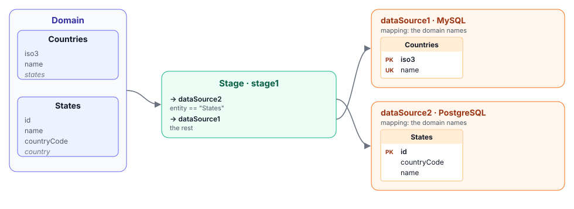

# Stage com múltiplas fontes {#stage-with-multiple-sources}

Esta página mostra um stage cujas entidades são armazenadas em bancos de dados diferentes, primeiro com o mesmo mapeamento e depois com um mapeamento diferente para cada fonte.

- Quando as entidades estão em bancos de dados diferentes, o stage indica qual fonte cada entidade usa.
- Isso é feito com a **condition** de cada regra de fonte: uma expressão avaliada para cada entidade; quando ela é verdadeira, essa fonte é usada.
- As condições são avaliadas na ordem do stage, então, quando uma entidade atende às condições de duas fontes, a primeira é usada. Uma fonte sem condição recebe as entidades que nenhuma fonte anterior recebeu.

## Múltiplas fontes compartilhando o mapeamento {#multiple-sources-sharing-the-mapping}

Neste esquema, `States` é armazenada em um banco de dados PostgreSQL (`dataSource2`) e todas as outras entidades em um banco de dados MySQL (`dataSource1`).
As duas fontes usam o mesmo mapeamento (o padrão, já que nenhum é definido), então as tabelas e colunas têm os mesmos nomes que as entidades e propriedades.



```yaml
domain:
  entities:
    - name: Countries
      primaryKey: ["iso3"]
      uniqueKey: ["name"]
      properties:
        - name: name
          required: true
        - name: iso3
          length: 3
          required: true
      relations:
        - name: states
          type: manyToOne
          composite: true
          from: iso3
          entity: States
          to: countryCode
    - name: States
      primaryKey: ["id"]
      uniqueKey: ["countryCode", "name"]
      properties:
        - name: id
          type: integer
          required: true
        - name: name
          required: true
        - name: countryCode
          required: true
          length: 3
      relations:
        - name: country
          from: countryCode
          entity: Countries
          to: iso3
infrastructure:          
  sources:
    - name: dataSource1
      dialect: MySQL
      connection:
        host: localhost
        port: 3306
        user: test
        password: test
        database: test
    - name: dataSource2
      dialect: PostgreSQL
      connection:
        host: localhost
        port: 5432
        user: test
        password: test
        database: test
  stages:
    - name: stage1
      sources:
        - name: dataSource2
          condition: entity == "States"
        - name: dataSource1
```

## Múltiplas fontes com mapeamentos diferentes {#multiple-sources-with-different-mappings}

Neste esquema, `dataSource1` é um banco de dados MySQL que contém a tabela `Countries`, e `dataSource2` é um banco de dados PostgreSQL que contém a tabela `States`.

Para `Countries`, os nomes da tabela e de suas colunas são os mesmos que os nomes da entidade e de suas propriedades, então seu mapeamento (`mapping1`) está vazio.
Para `States`, os nomes da tabela e de suas colunas são diferentes, então `mapping2` os define.


```yaml
domain:
  entities:
    - name: Positions
      abstract: true
      properties:
        - name: latitude
          length: 16
        - name: longitude
          length: 16
    - name: Countries
      extends: Positions
      primaryKey: ["iso3"]
      uniqueKey: ["name"]
      properties:
        - name: name
          required: true
        - name: iso3
          length: 3
          required: true
        - name: region
        - name: subregion
      relations:
        - name: states
          type: manyToOne
          composite: true
          from: iso3
          entity: States
          to: countryCode
    - name: States
      extends: Positions
      primaryKey: ["id"]
      uniqueKey: ["countryCode", "name"]
      properties:
        - name: id
          type: integer
          required: true
        - name: name
          required: true
        - name: countryCode
          required: true
          length: 3
      relations:
        - name: country
          from: countryCode
          entity: Countries
          to: iso3
infrastructure:
  mappings:
    - name: mapping1
    - name: mapping2
      entities:
        - name: States
          mapping: TBL_STATES
          properties:
            - name: id
              mapping: ID
            - name: name
              mapping: NAME
            - name: countryCode
              mapping: COUNTRY_CODE
            - name: latitude
              mapping: LATITUDE
            - name: longitude
              mapping: LONGITUDE          
  sources:
    - name: dataSource1
      dialect: MySQL
      mapping: mapping1
      connection: $CNN_MYSQL
    - name: dataSource2
      dialect: PostgreSQL
      mapping: mapping2
      connection: $CNN_POSTGRES
  stages:
    - name: stage1
      sources:
        - name: dataSource2
          condition: entity == "States"
        - name: dataSource1
```

**Variáveis de ambiente:**

```sh
CNN_MYSQL={"host":"localhost","port":3306,"user":"test","password":"test","database":"test"}
CNN_POSTGRES={"host":"localhost","port":5433,"user":"test","password":"test","database":"test"}
```

## Laboratórios {#labs}

- [CLI - duas fontes, mesma consulta](https://github.com/lambda-orm/lambdaorm-labs/tree/main/labs/cli/04-two-datasource-same-query)
